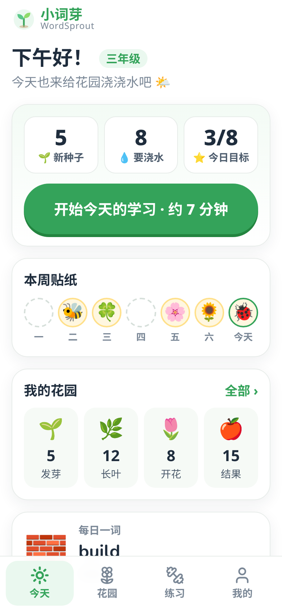
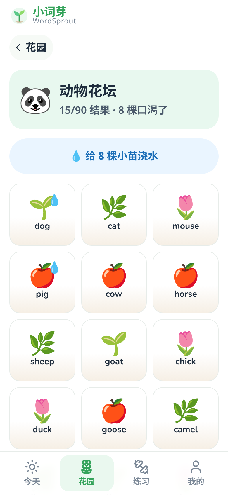
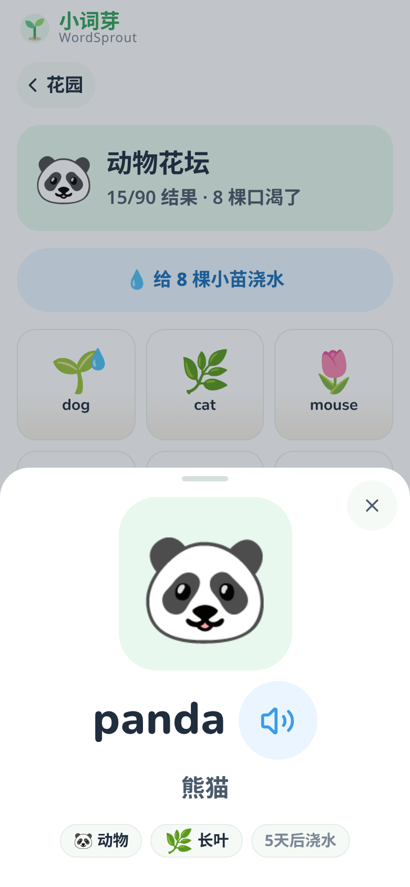
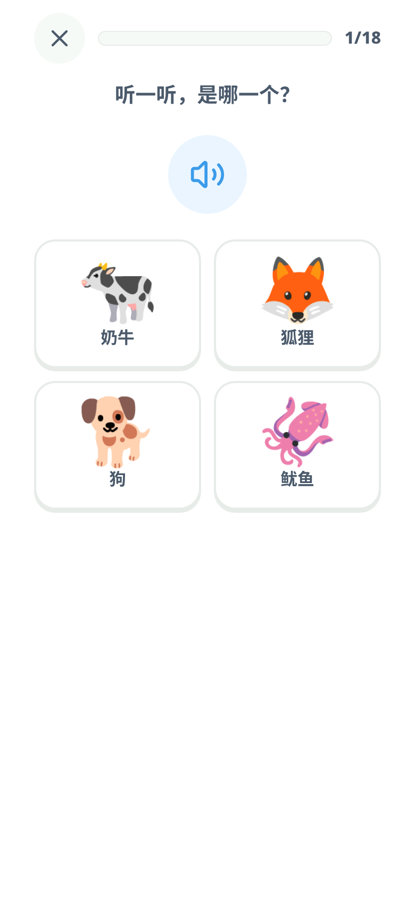

# 小词芽 WordSprout 🌱

给小学 1–6 年级孩子的英语单词花园。每天学几个单词，把它们种成一座花园：
学会一个词就种下一颗种子，按时复习（浇水）它就会发芽、长叶、开花、结果。

> Based on Word Atlas (MIT) by designfuchen / Word Atlas contributors —
> https://github.com/designfuchen/word-atlas . See [LICENSE](LICENSE) and [NOTICE](NOTICE).

- **白底极简、儿童友好**：只有浅色主题，大按钮、大字号，低年级字号更大。
- **不用注册账号**：所有学习记录只保存在这台设备的浏览器里（可导出/导入备份）。
- **按年级分层**：首次打开选择年级，决定每天新词数量、练习题型和复习节奏。
- **手机能发音**：系统英文语音 → 有道词典发音（美音 type=2 / 英音 type=1）→ Google 翻译发音，依次兜底。
- **离线可用**：PWA，装到主屏幕后断网也能学（发音需要系统语音或网络）。

| 引导选年级 | 今天 | 花园 | 单词卡 | 练习 |
|---|---|---|---|---|
|  |  |  |  |  |

## 运行

```bash
npm install
npm run dev        # http://localhost:5173
npm test           # node:test 单元测试
npm run build      # 类型检查 + 生产构建到 dist/
npm run preview    # 预览 dist/
```

截图（Playwright Chromium, 390×844）：先 `npm run build && npx vite preview --port 5188`，再
`npm run screenshots`（如本机已有 Chromium，可设 `CHROMIUM_PATH=/path/to/chrome`）。

部署（Cloudflare Pages 预览分支）：

```bash
npx wrangler pages deploy dist --project-name=xiaociya --branch=atlas
```

## 词库与年级分层

`src/data/lexicon.json` 共 **395 个词、10 个主题**（动物、水果、数字、颜色、身体、食物、交通、家庭、日历、动作），
每个词带中文释义和 emoji 图。词库自带难度 `level 1–3`，映射为三个学段（`src/atlas/lexicon.ts`）：

| 学段 | 适合年级 | 来源 | 词数 |
|---|---|---|---|
| 1 低段 | 1–2 年级 | level 1（另把 grandfather / grandmother 提到低段，教材一年级就出现） | 219 |
| 2 中段 | 3–4 年级 | level 2 | 144 |
| 3 高段 | 5–6 年级 | level 3 | 32 |

孩子选的年级决定学段（`src/lib/grade.ts`）。新词优先出自己学段及更简单学段的词，学完再出更难的词。

| 学段 | 每天新词 | 题型 | 拼写 | 最长复习间隔 | 字号 |
|---|---|---|---|---|---|
| 1 | 5 | 听音选图、看图选词 | 无 | 30 天 | ×1.22 |
| 2 | 8 | + 选中文 | 字母拼拼乐 | 60 天 | ×1.1 |
| 3 | 10 | + 选中文 | 键盘拼写 | 180 天 | ×1 |

## 单词花园

每个主题是一个花坛，每个词是一株植物，成长阶段由 FSRS 记忆稳定度 `s`（天）决定（`src/lib/garden.ts`）：

🌰 种子（还没学） → 🌱 发芽（新学或刚答错） → 🌿 长叶（s < 7） → 🌷 开花（7 ≤ s < 21） → 🍎 结果（s ≥ 21）。

到期需要复习的词显示 💧 “口渴了”，点“浇水”就会练习这些词。一个花坛全部结果会获得 🏅。

## 代码结构

```
src/atlas      词库加载与学段（lexicon.ts）
src/lib        年级配置、花园阶段、发音、音效、路由、贴纸
src/store      本地存储、设置迁移、FSRS 调度、学习会话
src/pages      Onboarding / Today / Garden / Learn / Practice / Me / About
src/ui         Logo、Plant、WordCard、SpeakButton、Sheet、Toast
```

## License

MIT — see [LICENSE](LICENSE). 基于 Word Atlas（MIT），详见 [NOTICE](NOTICE)。
